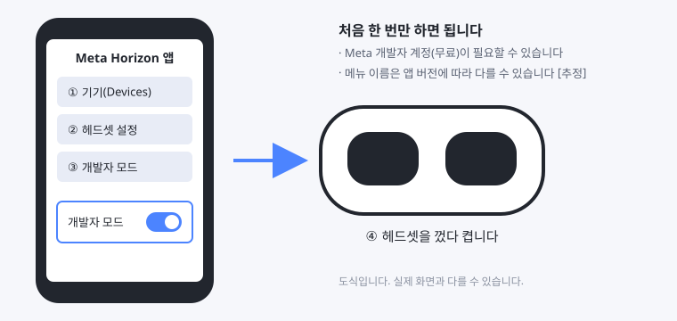
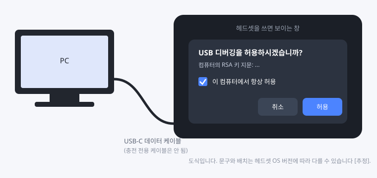
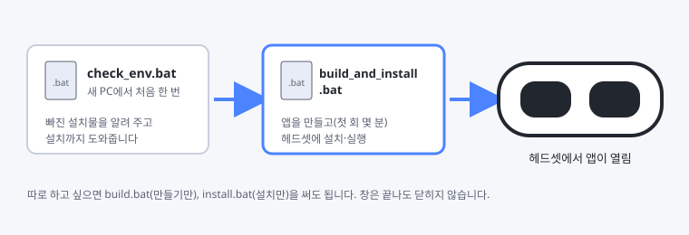
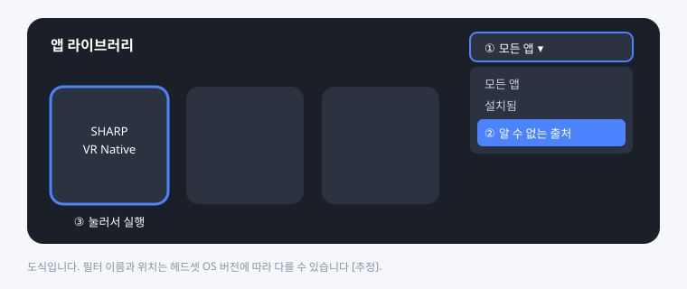
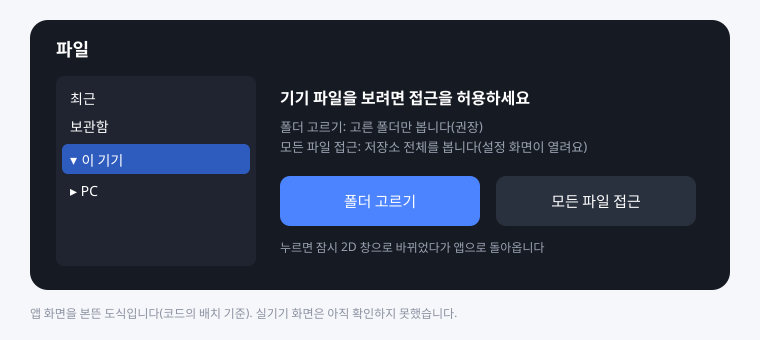
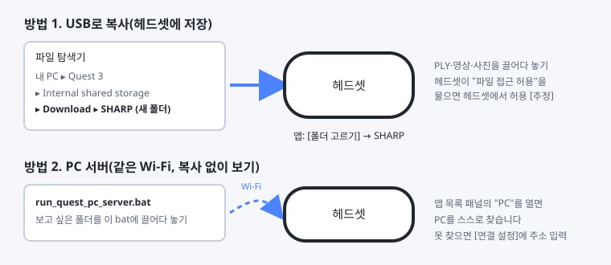
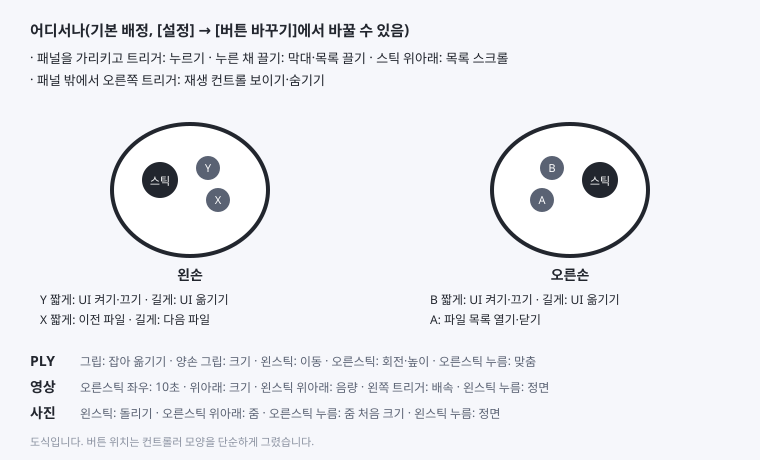

# Quest 3에 앱 설치하고 쓰기

이 문서는 PC에서 앱을 만들어 Quest 3 헤드셋에 넣고 쓰는 순서를 적는다.
Quest 개발을 몰라도 따라 할 수 있게 썼다.

- 그림은 직접 그린 도식이다. 실제 화면과 글자·배치가 다를 수 있다.
- **[추정]** 표시는 실제 헤드셋에서 아직 확인하지 못한 부분이다. 맨 아래 "실기기 확인 뒤 고칠 것"에 모아 두었다.

## 한눈에 보기

| 순서 | 할 일 | 몇 번 |
|---|---|---|
| 1 | 헤드셋 개발자 모드 켜기 | 처음 한 번 |
| 2 | 새 PC 준비: `check_env.bat` 더블클릭 | PC마다 처음 한 번 |
| 3 | 헤드셋을 USB로 연결하고 "USB 디버깅 허용" | PC마다 처음 한 번 |
| 4 | `build_and_install.bat` 더블클릭 | 앱을 바꿀 때마다 |
| 5 | 헤드셋에서 앱 실행(앱 목록 > 알 수 없는 출처) | 쓸 때마다 |
| 6 | 처음 실행 때 파일 접근 허용 | 처음 한 번 |
| 7 | 파일 넣기(USB 복사 또는 PC 서버) | 필요할 때 |

bat 파일은 모두 `quest-native` 폴더 안에 있다.
창은 끝나도 저절로 닫히지 않는다. 내용을 읽고 아무 키나 누르면 닫힌다.

## 1. 헤드셋 개발자 모드 켜기(처음 한 번)

1. 휴대폰에서 **Meta Horizon** 앱을 연다(헤드셋을 처음 설정할 때 쓴 앱).
2. **기기** → 내 헤드셋 → **헤드셋 설정** → **개발자 모드**를 켠다.
   - Meta 개발자 계정(무료)을 만들라고 할 수 있다. 안내를 따라 만든다. **[추정]**
3. 헤드셋을 껐다 켠다.

## 2. 새 PC 준비(PC마다 처음 한 번)

`check_env.bat`을 더블클릭한다.
빌드에 필요한 것이 있는지 확인하고, 빠진 것을 알려 준다.

| 필요한 것 | 받는 곳 |
|---|---|
| Android Studio(JDK와 Android SDK가 함께 들어온다) | https://developer.android.com/studio |
| Android SDK Platform 36, NDK 28.1.13356709, CMake 3.22.1, Build-Tools, Platform-Tools | `check_env.bat`이 "지금 설치할까요?"라고 물으면 **Y**. 인터넷이 필요하고 몇 GB를 받는다 |
| 빌드할 드라이브의 빈 공간 5GB 정도 | — |

- Android Studio는 설치한 뒤 **한 번 실행해서 첫 설정을 끝내야** SDK 폴더가 생긴다.
- `check_env.bat`이 sdkmanager를 찾지 못하면, Android Studio의 SDK Manager에서 직접 고르는 방법을 화면에 알려 준다.
- 마지막에 "모두 준비됐습니다"가 나오면 다음 단계로 간다.

## 3. 헤드셋 연결과 "USB 디버깅 허용"(PC마다 처음 한 번)

1. 헤드셋을 켜고 USB-C **데이터** 케이블로 PC에 연결한다. 충전 전용 케이블로는 안 된다.
2. 헤드셋을 쓰면 **"USB 디버깅을 허용하시겠습니까?"** 창이 보인다.
3. **"이 컴퓨터에서 항상 허용"**에 체크하고 **[허용]**을 누른다.
   - 창이 안 보이면 케이블을 뺐다가 다시 꽂는다.
   - 창을 놓쳤으면 4단계의 bat이 "허용 필요"라고 알려 준다. 그때 헤드셋을 쓰고 허용한 뒤 bat 창에서 **R**(다시 확인)을 누른다.

## 4. 앱 만들고 설치하기

`build_and_install.bat`을 더블클릭한다.

- **[1/3] 필요한 설치물 확인 → [2/3] 서명 키 확인 → [3/3] 빌드** 순서로 진행한 뒤 헤드셋에 설치하고 앱을 켠다.
- 처음 빌드는 인터넷으로 부품을 받느라 몇 분 걸린다. 다음부터는 1분 안팎이다.
- 처음 빌드할 때 이 PC의 서명 키를 만든다: `C:\Users\<이름>\.sharp-quest-native\`. **이 폴더는 지우지 않는다.**
- 따로 하고 싶으면 `build.bat`(만들기만), `install.bat`(설치만)을 쓴다.

### bat이 멈추고 물어볼 때

| bat 화면 | 뜻 | 할 일 |
|---|---|---|
| [연결 없음] 헤드셋이 보이지 않습니다 | PC가 헤드셋을 못 찾음 | 헤드셋이 켜져 있는지, 데이터 케이블인지, 개발자 모드가 켜졌는지 확인하고 **R** |
| [허용 필요] | 헤드셋에서 USB 디버깅을 아직 허용하지 않음 | 헤드셋을 쓰고 허용(3단계) 후 **R** |
| [연결 불안정] offline | 연결이 반쯤 끊김 | 케이블을 다시 꽂거나 헤드셋을 다시 켜고 **R** |
| 기기가 2대 연결돼 있습니다 | 헤드셋·휴대폰 등 여러 대가 연결됨 | 설치할 기기 번호를 입력하고 Enter |
| [서명이 다름] | 다른 PC에서 만든 같은 앱이 이미 깔려 있음 | **Y**면 기존 앱을 지우고 새로 설치. 앱 안 설정·최근 목록·보관함·버튼 배정은 사라지고, 헤드셋에 넣어 둔 파일은 그대로 |
| [더 새 판이 있음] | 헤드셋의 앱이 이 APK보다 새 판 | 이 판으로 바꾸려면 **Y** |
| [공간 부족] | 헤드셋 저장 공간 부족 | 헤드셋에서 안 쓰는 앱·파일을 지우고 다시 실행 |
| [없음] JDK / Android SDK / NDK … | PC에 설치물이 없음 | `check_env.bat` 실행(2단계) |
| [부족] 드라이브 남은 공간 | PC 디스크 부족 | 파일을 지워 2GB 이상(권장 5GB) 비우기 |
| 빌드 실패 | 그 밖의 문제 | 창의 안내를 보고, 해결이 안 되면 창 내용을 복사해 개발 담당에게 보내기 |

## 5. 헤드셋에서 앱 실행

- 설치 직후에는 bat이 앱을 켜 두므로 헤드셋을 쓰면 바로 보인다.
- 다음부터는 **앱 라이브러리 → 필터 "알 수 없는 출처"** → **SHARP VR Native**를 누른다. **[추정: 필터 이름·위치]**

## 6. 처음 실행: 파일 접근 허용

앞에 **파일** 패널이 뜬다. 왼쪽에서 **이 기기**를 누르면 접근 안내가 나온다.

- **[폴더 고르기](권장)**: 파일을 넣어 둘 폴더(예: `Download/SHARP`)를 고른다. 고른 폴더만 앱이 본다.
  - 저장소 맨 위나 `Download` 폴더 자체는 고를 수 없다. 그 안의 폴더를 고른다. **[추정]**
- **[모든 파일 접근]**: 설정 화면에서 이 앱의 "모든 파일 접근"을 켠다. 저장소 전체를 본다.
- 두 버튼 모두 잠시 2D 창으로 바뀌었다가 앱으로 돌아온다. **[추정]**

## 7. 파일 넣기

### 방법 1. USB로 복사(헤드셋에 저장)

1. 헤드셋을 USB로 연결한 채 PC의 파일 탐색기에서 **Quest 3 → Internal shared storage**를 연다.
   - 헤드셋에 "파일 접근 허용" 창이 뜨면 헤드셋에서 허용한다. **[추정]**
2. `Download` 안에 `SHARP` 같은 폴더를 만들고, PLY·영상·사진을 끌어다 넣는다.
3. 앱에서 그 폴더를 고른다(6단계).

### 방법 2. PC 서버(복사 없이, 같은 Wi-Fi)

1. PC에서 저장소 맨 위의 `run_quest_pc_server.bat`을 켠다. 보고 싶은 폴더를 이 bat에 끌어다 놓으면 기억된다.
2. 헤드셋과 PC를 같은 Wi-Fi(같은 공유기)에 연결한다.
3. 앱의 파일 패널에서 **PC**를 연다. 앱이 PC를 스스로 찾는다.
4. 못 찾으면 카드의 **[연결 설정]**에서 PC 서버 창에 나온 주소(예: `192.168.0.23:8787`)를 입력한다.

자세한 내용: [pc-source.md](pc-source.md), 영상 형식 권장값: [encoding-guide.md](encoding-guide.md)

## 8. 기본 조작

| 조작 | 하는 일 |
|---|---|
| 패널을 가리키고 **트리거** | 누르기. 누른 채 끌면 막대·목록을 끈다 |
| 패널을 가리키고 **스틱 위아래** | 목록 스크롤(오래 밀수록 빨라짐) |
| **A** | 파일 목록 열기·닫기 |
| **B / Y** 짧게 · 길게 | UI 켜기·끄기 · UI를 지금 보는 곳으로 옮기기 |
| **X** 짧게 · 길게 | 이전 파일 · 다음 파일 |
| 패널 밖에서 **오른쪽 트리거** | 재생 컨트롤(HUD) 보이기·숨기기 |

- 버튼 배정은 파일 패널의 **[설정] → [버튼 바꾸기]**에서 바꾼다. 바꾼 뒤 10초 안에 [유지]를 누르지 않으면 원래대로 돌아간다.
- PLY·영상·사진마다의 조작은 그림 아래 줄과 같다. HUD의 [더 보기]/[PLY 옵션]에 나머지 기능이 있다.

## 앱 지우기·다시 깔기

- 헤드셋: 앱 라이브러리에서 앱의 [⋯] → 제거. **[추정]**
- PC: `install.bat`이 서명이 다른 앱을 만나면 지울지 묻는다.
- 다른 PC에서 만든 앱으로 바꾸면 서명이 달라서 기존 앱을 한 번 지워야 한다(서명 키는 PC마다 다르다, [release.md](release.md)).

## 실기기 확인 뒤 고칠 것

헤드셋에서 확인한 뒤 이 문서를 고친다.

1. Meta Horizon 앱의 개발자 모드 메뉴 경로와 개발자 계정 필요 여부(1단계)
2. "USB 디버깅 허용" 창의 실제 문구(3단계, 그림 02)
3. 앱 라이브러리의 "알 수 없는 출처" 필터 이름과 위치(5단계, 그림 04)
4. 폴더 선택기에서 `Download` 자체를 고를 수 없는지, 2D 창에서 앱으로 잘 돌아오는지(6단계)
5. PC 파일 탐색기에 Quest가 보일 때 헤드셋 쪽 허용 창이 뜨는지, 폴더 이름(7단계 방법 1)
6. 앱 제거 메뉴 위치
7. 그림 05(앱 첫 화면)를 실제 앱 화면과 맞추기
